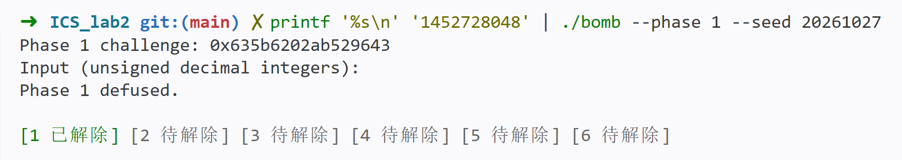
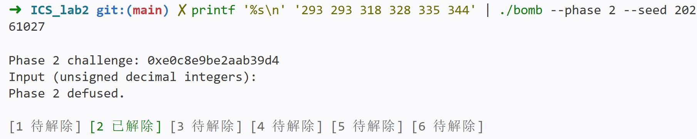
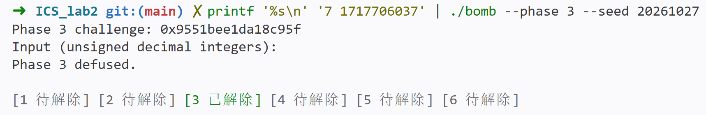
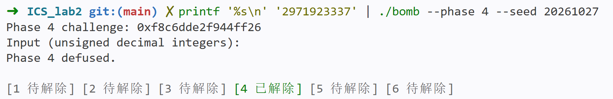
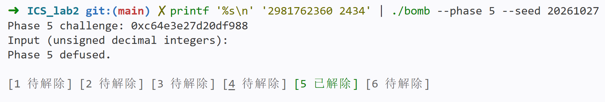
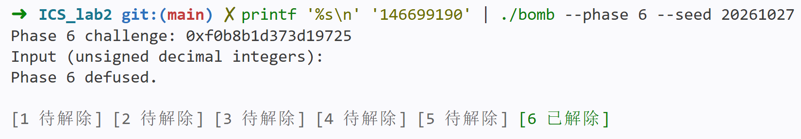
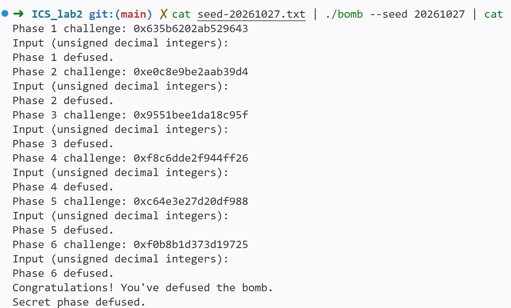
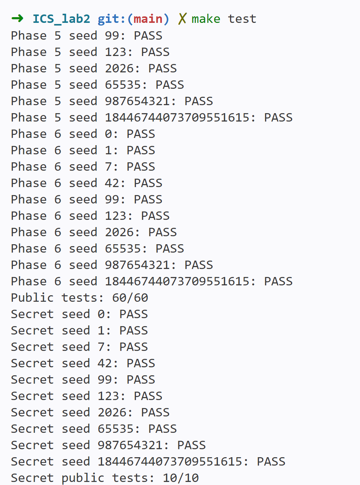

# BombLab 实验报告

## 实验环境与整体思路

本实验通过分析个人二进制程序 `bomb`，恢复各关从 `challenge` 到正确口令的计算关系，并在 `defuser.c` 中实现对应的求解函数。实验包含六个正式关卡和 Honor，求解函数需要适用于不同的 `challenge`。

实验使用 Linux x86-64 环境（Ubuntu / WSL2）编译和运行程序，使用 IDA Pro 9.4 阅读汇编、控制流和反编译结果。

使用 IDA Pro 打开 `bomb` 后，从 `main` 梳理执行流程：程序生成本关的 `challenge`，读取一行口令，再调用对应的 `phase` 函数。校验失败时，程序进入 `explode_bomb`，打印 `BOOM!!!` 并退出。

各关分析均围绕输入解析、参数传递、核心计算和最终比较展开，再用非公开 seed 核对恢复出的关系。本文汇编采用 Intel 语法，目的操作数在前、源操作数在后；列出的地址均对应本次使用的个人 `bomb`。

### 关于整数宽度

观察汇编时，需要区分寄存器宽度。例如，`shr rax, 0x20` 对 64 位值进行逻辑右移，而 `xor eax, edi` 执行 32 位异或。写入 `eax` 还会将 `rax` 的高 32 位清零。本文用以下记号表示取低 32 位：

```math
U(x)=x\bmod 2^{32}
```

用 `C` 表示本关 `challenge`，`H=C>>32` 表示其高 32 位；`XOR` 和公式中的异或符号均表示按位异或，`&` 表示按位与。本文右移均按无符号数解释，`ROL32` 和 `ROR32` 分别表示 32 位循环左移和循环右移。

正式六关的口令均由无符号 32 位整数组成。实现使用 `uint32_t` 保存相应中间结果，使加法、减法和乘法按模 `2^32` 回绕，与汇编中的 32 位运算一致。

### challenge 的生成

进入 `challenge_from_seed`，在 `0x4027c4` 开始可以看到：

```assembly
0x4027c4  mov rdx, 0x9e3779b97f4a7c15
0x4027ce  mov eax, esi
0x4027d0  add rax, 1
0x4027d4  imul rax, rdx
0x4027d8  add rax, rdi
```

这里的 `rdi` 是 seed，`esi` 是关卡编号。后面接着出现右移 `30`、`27`、`31` 位，以及两个乘法常数。反编译恢复为：

```c
static uint64_t mix64(uint64_t x) {
    x = (x ^ (x >> 30)) * UINT64_C(0xbf58476d1ce4e5b9);
    x = (x ^ (x >> 27)) * UINT64_C(0x94d049bb133111eb);
    return x ^ (x >> 31);
}

C = mix64(seed + UINT64_C(0x9e3779b97f4a7c15) * (phase + 1));
```

上述加法和乘法均按 64 位无符号整数计算。正式关卡对应 `phase=1..6`，Honor 使用编号 `7`。这一关系也可与仓库中的 `challenge.c` 对照。驱动会把生成的 `challenge` 传给求解函数，解法中无需自行处理 seed。

### 使用的验证 seed

`tests/public.json` 中的十个公开 seed 如下：

```text
0, 1, 7, 42, 99, 123, 2026, 65535, 987654321, 18446744073709551615
```

各关均使用 `seed=20261027` 记录非公开输入的验证过程。该 seed 不在上述公开列表中；各关生成的 `challenge` 分别记录在对应小节。

### 公共辅助代码

以下公共代码及各关“求解实现”均摘自当前 `defuser.c`。公共部分包含头文件、整数输出函数、循环移位函数和高低位折叠函数，供后续各关使用。

```c
#include "defuser.h"

#include <inttypes.h>
#include <stdio.h>

#define MAX_FIELDS 8

/* Write exactly count unsigned decimal integers, separated by spaces. */
static int write_answer(char *out, size_t cap,
                        const uint32_t *values, size_t count) {
    size_t used = 0;

    if (out == NULL || values == NULL || cap == 0 || count == 0) return 1;

    out[0] = '\0';
    for (size_t i = 0; i < count; ++i) {
        int size = snprintf(out + used, cap - used,
                            "%s%" PRIu32, i ? " " : "", values[i]);
        if (size < 0 || (size_t)size >= cap - used) return 1;
        used += (size_t)size;
    }
    return 0;
}

/* All arithmetic below intentionally wraps modulo 2^32. */
static uint32_t rol32(uint32_t value, unsigned bits) {
    bits &= 31u;
    return (uint32_t)((value << bits) | (value >> ((32u - bits) & 31u)));
}

static uint32_t ror32(uint32_t value, unsigned bits) {
    bits &= 31u;
    return (uint32_t)((value >> bits) | (value << ((32u - bits) & 31u)));
}

static uint32_t fold64(uint64_t value) {
    return (uint32_t)value ^ (uint32_t)(value >> 32);
}
```

## Phase 1

`phase_01` 读取一个无符号整数，调用 `p1_compute` 后，将返回值与该输入比较：

```assembly
0x4020db  call p1_compute
0x4020e0  cmp DWORD PTR [rbp-0x14], eax
0x4020e3  sete al
```

因此，本关口令就是 `p1_compute(challenge)` 的返回值。

继续分析 `p1_compute`，重点追踪 challenge 的拆分方式，以及三次调用之间的参数和返回值传递：

```assembly
0x402055  mov rdx, rdi
0x402058  mov rax, rdi
0x40205b  shr rax, 0x20
0x40205f  mov rsi, rdx
0x402062  mov edi, eax
0x402064  shr rsi, 0x10
0x40206b  call p1_step1
0x402070  mov esi, edi
0x402072  mov edi, edx
0x402074  mov ecx, eax
0x402076  call p1_step0
0x40207b  mov esi, ecx
0x40207d  mov edi, eax
0x40207f  call p1_step2
```

在第一次调用之前，`edi` 保存 `H`，`rsi` 保存 `C>>16`。注意实际参与小函数计算的是它们的低 32 位。三个小函数中的关键指令分别为：

```assembly
; p1_step1
0x402034  lea eax, [rdi+rsi*4]
0x402037  xor eax, 0x1134

; p1_step0
0x402024  xor esi, 0xee51
0x40202a  lea eax, [rsi+rdi*8]

; p1_step2
0x402044  lea eax, [rsi+0xc21d]
0x40204a  xor eax, edi
```

第一次调用得到：

```math
t=U(H+4U(C>>16))\oplus 0x1134
```

检查 `p1_step1` 的具体指令可知，它没有修改 `edi` 和保存原始 challenge 的 `rdx`。因此第二次调用时，`edi` 被设置为 `U(C)`，`esi` 被设置为 `H`，得到：

```math
v=U((H\oplus 0xee51)+8U(C))
```

最后，`p1_step2` 的两个参数是 `v` 和 `t`，所以本关输入为：

```math
answer=v\oplus U(t+0xc21d)
```

本关中，IDA 伪代码出现了看似未初始化的中间变量。对照调用前后的汇编后，可以确认所需值仍保存在这些小函数未修改的寄存器中。这里的保留关系来自对具体指令的检查，不能仅凭调用约定假定调用者保存寄存器在函数返回后不变。

### 求解实现

```c
int solve_phase_1(uint64_t challenge, char *out, size_t cap) {
    uint32_t values[MAX_FIELDS] = {0};
    uint32_t high = (uint32_t)(challenge >> 32);
    uint32_t step1 = (high + UINT32_C(4) * (uint32_t)(challenge >> 16))
                     ^ UINT32_C(0x1134);
    uint32_t step0 = (high ^ UINT32_C(0xee51))
                     + UINT32_C(8) * (uint32_t)challenge;

    values[0] = step0 ^ (step1 + UINT32_C(0xc21d));
    return write_answer(out, cap, values, 1);
}
```

### 非公开 seed 验证

`seed=20261027` 时，`C=0x635b6202ab529643`。计算得到：

```text
H     = 1666933250
step1 = 3949338238
step0 = 3186638443
answer = 1452728048
```

运行：

```shell
➜  ICS_lab2 git:(main) ✗ printf '%s\n' '1452728048' | ./bomb --phase 1 --seed 20261027
Phase 1 challenge: 0x635b6202ab529643
Input (unsigned decimal integers):
Phase 1 defused.
```

输出 `Phase 1 defused.`，与计算结果一致。



## Phase 2

进入 `phase_02`，可以看到 `valid_u32_fields` 和 `sscanf` 均要求输入六个整数。读取完成后，程序先检查第一个数：

```assembly
0x40215a  mov rax, r13
0x40215d  mov esi, DWORD PTR [rbp-0x40]
0x402160  shr rax, 0x2f
0x402164  add eax, eax
0x402166  and eax, 0x1fe
0x40216b  add eax, 3
0x40216e  cmp esi, eax
```

`r13` 保存本关 challenge，`esi` 是第一个输入整数。右移 `0x2f=47` 位后乘以 `2`，再与 `0x1fe` 按位与，等价于取右移结果的低 8 位再乘以 `2`。因此：

```math
a_0=2((C>>47)\ \&\ 255)+3
```

后面五个数在一个循环中检查：

```assembly
0x402176  mov edi, 10
0x40217b  mov ecx, 24
0x402180  mov rax, r13
0x402183  shr rax, cl
0x402186  and eax, 0x1f
0x402189  add eax, esi
0x40218b  mov esi, DWORD PTR [rdx+4]
0x40218e  xor eax, edi
0x402190  cmp esi, eax
0x402194  add ecx, 3
0x402197  add edi, 10
0x40219a  add rdx, 4
0x40219e  cmp ecx, 39
0x4021a1  jne 0x402180
```

第一次循环使用右移位数 `24` 和异或常数 `10`，之后分别增加 `3` 和 `10`。`add eax, esi` 中的 `esi` 仍然是前一个输入，下一条指令才把它更新成当前待检查的输入。

由此得到递推式：

```math
a_i=U\left(a_{i-1}+((C>>(21+3i))\ \&\ 31)\right)\oplus(10i),\quad i=1,\ldots,5
```

需要注意，最后一次使用的右移位数是 `36`。循环在把计数器加到 `39` 后结束，不能额外再计算一项。

### 求解实现

```c
int solve_phase_2(uint64_t challenge, char *out, size_t cap) {
    uint32_t values[MAX_FIELDS] = {0};

    values[0] = UINT32_C(2) * ((uint32_t)(challenge >> 47) & UINT32_C(255))
                + UINT32_C(3);
    for (unsigned i = 1; i < 6; ++i) {
        uint32_t delta = (uint32_t)(challenge >> (21u + 3u * i)) & UINT32_C(31);
        values[i] = (values[i - 1] + delta) ^ (UINT32_C(10) * i);
    }
    return write_answer(out, cap, values, 6);
}
```

### 非公开 seed 验证

`seed=20261027` 时，`C=0xe0c8e9be2aab39d4`。第一个数为 `293`，五次截取出的增量依次为 `10, 5, 24, 31, 27`。

例如，前两次递推为：

```text
a[1] = (293 + 10) XOR 10 = 293
a[2] = (293 +  5) XOR 20 = 318
```

最终得到 `293 293 318 328 335 344`。

```shell
➜  ICS_lab2 git:(main) ✗ printf '%s\n' '293 293 318 328 335 344' | ./bomb --phase 2 --seed 20261027
Phase 2 challenge: 0xe0c8e9be2aab39d4
Input (unsigned decimal integers):
Phase 2 defused.
```



## Phase 3

`phase_03` 要求输入两个整数。第一个整数先和 challenge 的低 3 位比较：

```assembly
0x4022fc  mov edi, r12d
0x402301  and edi, 7
0x402304  cmp DWORD PTR [rbp-0x18], edi
```

因此，第一个整数由 challenge 的低 3 位确定：

```math
index=C\ \&\ 7
```

第二个整数由 `p3_dispatch` 的返回值决定。调用前的关键指令为：

```assembly
0x402309  mov rax, r12
0x40230c  mov rsi, r12
0x40230f  shr rax, 3
0x402313  shr rsi, 32
0x402317  xor esi, eax
0x402319  call p3_dispatch
0x40231e  cmp DWORD PTR [rbp-0x14], eax
```

所以传给分支函数的数为：

```math
x=U(C>>3)\oplus H
```

进入 `p3_dispatch`，可以看到按 `index*8` 访问跳转表：

```assembly
0x402254  mov eax, edi
0x402256  mov edi, esi
0x402258  cmp eax, 7
0x40225d  notrack jmp QWORD PTR [rax*8+0x405820]
```

分支顺序需要按跳转表中的实际目标恢复。查看各表项指向的函数后，得到以下对应关系；函数名后缀与表下标的顺序不同：

| index | 实际调用函数 | 第二个整数，结果取低 32 位  |
| :---: | :----------- | :-------------------------- |
|   0   | `p3_case_7`  | `(x >> 2) + (x XOR 0xae7a)` |
|   1   | `p3_case_3`  | `(x >> 1) + (x XOR 0x314e)` |
|   2   | `p3_case_5`  | `U(4*x) XOR 0x4c04`         |
|   3   | `p3_case_2`  | `U(2*x) XOR 0x542a`         |
|   4   | `p3_case_0`  | `5*x + 61838`               |
|   5   | `p3_case_4`  | `5*x + 261225`              |
|   6   | `p3_case_6`  | `3*x + 55940`               |
|   7   | `p3_case_1`  | `5*x + 316995`              |

因此，解法就是从 challenge 计算 `index` 和 `x`，按上表选择公式，输出 `index answer`。

### 求解实现

```c
int solve_phase_3(uint64_t challenge, char *out, size_t cap) {
    uint32_t values[MAX_FIELDS] = {0};
    uint32_t index = (uint32_t)challenge & UINT32_C(7);
    uint32_t x = (uint32_t)(challenge >> 3) ^ (uint32_t)(challenge >> 32);

    values[0] = index;
    /* The switch order differs from the numeric suffixes of p3_case_N. */
    switch (index) {
        case 0: values[1] = (x >> 2) + (x ^ UINT32_C(0xae7a)); break;
        case 1: values[1] = (x >> 1) + (x ^ UINT32_C(0x314e)); break;
        case 2: values[1] = (UINT32_C(4) * x) ^ UINT32_C(0x4c04); break;
        case 3: values[1] = (UINT32_C(2) * x) ^ UINT32_C(0x542a); break;
        case 4: values[1] = UINT32_C(5) * x + UINT32_C(61838); break;
        case 5: values[1] = UINT32_C(5) * x + UINT32_C(261225); break;
        case 6: values[1] = UINT32_C(3) * x + UINT32_C(55940); break;
        case 7: values[1] = UINT32_C(5) * x + UINT32_C(316995); break;
    }
    return write_answer(out, cap, values, 2);
}
```

### 非公开 seed 验证

本次 `C=0x9551bee1da18c95f`，所以：

```text
index = 7
x = 2920458186
answer = U(5*x + 316995) = 1717706037
```

运行：

```shell
➜  ICS_lab2 git:(main) ✗ printf '%s\n' '7 1717706037' | ./bomb --phase 3 --seed 20261027
Phase 3 challenge: 0x9551bee1da18c95f
Input (unsigned decimal integers):
Phase 3 defused.
```

这里乘法结果超过 `2^32-1`，因此最终截断十分重要。若直接输出未截断的十进制结果，输入格式检查就会失败。



## Phase 4

进入 `phase_04`，发现它只接受一个整数。核心调用为 `p4_walk`，调用前取 challenge 的低 7 位作为目标，设置区间为 `[0,127]`：

```assembly
0x4023f1  xor esi, esi
0x4023f3  shr rax, 32
0x4023f7  shr rcx, 7
0x4023fb  and edi, 0x7f
0x4023fe  mov edx, 0x7f
0x402403  xor ecx, eax
0x402405  call p4_walk
```

这里四个参数依次为：

```text
target = C & 127
low = 0
high = 127
salt = H XOR U(C >> 7)
```

接下来看递归函数。开头先计算区间中点：

```assembly
0x402338  sub edi, esi
0x40233a  shr edi, 1
0x40233c  add edi, esi
0x40233e  cmp edi, eax
0x402340  je 0x402390
```

中点公式为 `mid=low+((high-low)>>1)`。命中目标时，直接返回：

```assembly
0x402390  lea eax, [rdi+0x51]
0x402393  xor eax, ecx
```

即 `salt XOR (mid+81)`。

没有命中时，程序根据目标位于中点的哪一侧继续递归。右分支把下界设为 `mid+1`；左分支把上界设为 `mid-1`。递归返回后都会乘以 `5`，再与 `mid+salt` 异或，区别在最后的常数：

```assembly
; 向右递归后的返回值处理
0x40235c  lea eax, [rax+rax*4]
0x40235f  xor eax, ebx
0x402366  xor eax, 1

; 向左递归后的返回值处理
0x40237a  lea eax, [rax+rax*4]
0x40237d  xor eax, ebx
0x402384  xor eax, 0x15
```

其中 `ebx` 在递归前通过 `lea ebx, [rdi+rcx]` 保存了 `mid+salt`。恢复关系为：

```math
F(t,l,r,s)=
\begin{cases}
s\oplus(m+81), & t=m,\\
U(m+s)\oplus U(5F(t,l,m-1,s))\oplus 0x15, & t<m,\\
U(m+s)\oplus U(5F(t,m+1,r,s))\oplus 1, & t>m,
\end{cases}
```

其中 `m=l+((r-l)>>1)`。本关输入就是 `F(target,0,127,salt)`。

实现中保留相同的递归结构，重点对应递归区间、终止条件和返回值的计算顺序。目标由 challenge 的低 7 位确定，始终位于初始区间 `[0,127]` 内。

### 求解实现

```c
static uint32_t p4_walk(uint32_t target, uint32_t low,
                        uint32_t high, uint32_t salt) {
    uint32_t middle = low + ((high - low) >> 1);
    uint32_t child;

    if (middle == target) return salt ^ (middle + UINT32_C(81));
    if (target < middle) {
        child = p4_walk(target, low, middle - UINT32_C(1), salt);
        return (middle + salt) ^ (UINT32_C(5) * child) ^ UINT32_C(0x15);
    }
    child = p4_walk(target, middle + UINT32_C(1), high, salt);
    return (middle + salt) ^ (UINT32_C(5) * child) ^ UINT32_C(1);
}

int solve_phase_4(uint64_t challenge, char *out, size_t cap) {
    uint32_t values[MAX_FIELDS] = {0};
    uint32_t salt = (uint32_t)(challenge >> 32) ^ (uint32_t)(challenge >> 7);

    values[0] = p4_walk((uint32_t)challenge & UINT32_C(127), 0, 127, salt);
    return write_answer(out, cap, values, 1);
}
```

### 非公开 seed 验证

`C=0xf8c6dde2f944ff26` 时：

```text
target = 38
salt = 1026839580
二分中点：63 → 31 → 47 → 39 → 35 → 37 → 38
最终返回值：2971923337
```

按上述路径递归，再从命中位置向外计算返回值，得到输入 `2971923337`。

```shell
➜  ICS_lab2 git:(main) ✗ printf '%s\n' '2971923337' | ./bomb --phase 4 --seed 20261027
Phase 4 challenge: 0xf8c6dde2f944ff26
Input (unsigned decimal integers):
Phase 4 defused.
```



## Phase 5

`phase_05` 读取两个整数，再调用 `p5_traverse`。函数的返回值对应第一个整数，通过指针参数写出的值对应第二个整数。

先看函数如何选择起始位置：

```assembly
0x402424  mov rax, rdi
0x402427  mov rcx, rdi
0x40242a  mov r8, rsi
0x40242d  and eax, 7
0x402430  shr rcx, 3
0x402434  mov rdx, QWORD PTR [rax*8+0x405b60]
```

这里的 `0x405b60` 是一个指针表，`C&7` 选择八个入口之一。后续代码又分别读取 `[rdx]`、`[rdx+8]` 和 `[rdx+12]`：

```assembly
0x402449  mov esi, DWORD PTR [rdx+8]
0x402453  add eax, DWORD PTR [rdx+12]
0x402456  lea eax, [rax+rax*4]
0x402459  mov DWORD PTR [r8], esi
0x40245c  xor eax, esi
...
0x402468  mov rdx, QWORD PTR [rdx]
```

`[rdx]` 被作为下一个地址使用，所以它是链表指针；后面的两个字段各占 4 字节。由此可以恢复节点布局：

```c
struct Node {
    struct Node *next;  // 偏移 0，8 字节
    uint32_t value;     // 偏移 8
    uint32_t salt;      // 偏移 12
};
```

结合字段访问和静态数据，将从 `0x405ba0` 开始的节点按每个 16 字节编号，得到下表。实现中用节点编号表示 `next`，保留原链表的连接关系；解法数组自身的内存布局无需与炸弹中的节点布局相同。

| 编号 | 原地址     | next 编号 | value |  salt |
| :--: | :--------- | :-------: | ----: | ----: |
|  0   | `0x405ba0` |    10     |  2834 | 37899 |
|  1   | `0x405bb0` |     6     |  2110 | 50451 |
|  2   | `0x405bc0` |     5     |   262 | 20605 |
|  3   | `0x405bd0` |     0     |  2434 |  8976 |
|  4   | `0x405be0` |    11     |  1606 | 61672 |
|  5   | `0x405bf0` |     9     |  2673 | 25107 |
|  6   | `0x405c00` |     4     |   550 | 59135 |
|  7   | `0x405c10` |     2     |   898 |  5417 |
|  8   | `0x405c20` |     3     |  1839 | 56710 |
|  9   | `0x405c30` |     1     |  1130 | 21168 |
|  10  | `0x405c40` |     7     |  1412 | 50452 |
|  11  | `0x405c50` |   NULL    |   102 | 41699 |

八个入口依次对应节点编号：

```c
static const unsigned heads[8] = {8, 3, 0, 10, 7, 2, 5, 9};
```

累积值的初始状态由右移和异或得到：

```assembly
0x40243f  shr rdi, 32
0x402443  shr rax, 6
0x402447  xor eax, edi
0x40244e  xor eax, 0x8562
```

所以初始值为：

```math
acc_0=H\oplus U(C>>6)\oplus 0x8562
```

处理一个节点时，先加上 `salt`，再乘以 `5`，最后与 `value` 异或：

```math
acc_{j+1}=node_j.value\oplus U(5U(node_j.salt+acc_j))
```

处理次数需要再看循环边界：

```assembly
0x40245e  and edi, 3
0x402461  je 0x402480
0x402463  mov ecx, 1
0x402468  mov rdx, QWORD PTR [rdx]
...
0x40247c  cmp edi, ecx
0x40247e  jae 0x402468
```

进入循环前已经处理过一次起始节点。因此总处理次数是：

```math
steps=1+((C>>3)\ \&\ 3)
```

每处理一个节点，`[r8]` 都被当前节点的 `value` 覆盖。因此，输出的第一个整数是最终累积值，第二个整数是最后一个被处理节点的 `value`。

### 求解实现

```c
struct p5_node {
    unsigned next;
    uint32_t value;
    uint32_t salt;
};

/* Indices correspond to (original address - 0x405ba0) / 16. */
static const struct p5_node p5_nodes[12] = {
    {10, 2834, 37899}, {6, 2110, 50451}, {5, 262, 20605},
    {0, 2434, 8976}, {11, 1606, 61672}, {9, 2673, 25107},
    {4, 550, 59135}, {2, 898, 5417}, {3, 1839, 56710},
    {1, 1130, 21168}, {7, 1412, 50452}, {12, 102, 41699}
};

static const unsigned p5_heads[8] = {8, 3, 0, 10, 7, 2, 5, 9};

int solve_phase_5(uint64_t challenge, char *out, size_t cap) {
    uint32_t values[MAX_FIELDS] = {0};
    unsigned node = p5_heads[challenge & UINT64_C(7)];
    unsigned steps = (unsigned)((challenge >> 3) & UINT64_C(3)) + 1u;
    uint32_t accumulator = (uint32_t)(challenge >> 32)
                            ^ (uint32_t)(challenge >> 6) ^ UINT32_C(0x8562);

    for (unsigned i = 0; i < steps; ++i) {
        const struct p5_node *current = &p5_nodes[node];
        accumulator = current->value ^ (UINT32_C(5) * (current->salt + accumulator));
        values[1] = current->value;
        node = current->next;
    }
    values[0] = accumulator;
    return write_answer(out, cap, values, 2);
}
```

### 非公开 seed 验证

本次 `C=0xc64e3e27d20df988`，计算得到：

```text
head_index = 0，即从编号 8 的节点开始
steps = 2
初始 acc = 1493601443
```

实际经过的节点及结果为：

| 次数 | 节点地址   | value |  salt | 更新后的 acc |
| :--: | :--------- | ----: | ----: | -----------: |
|  1   | `0x405c20` |  1839 | 56710 |   3173324258 |
|  2   | `0x405bd0` |  2434 |  8976 |   2981762360 |

因此输入为 `2981762360 2434`。

```shell
➜  ICS_lab2 git:(main) ✗ printf '%s\n' '2981762360 2434' | ./bomb --phase 5 --seed 20261027
Phase 5 challenge: 0xc64e3e27d20df988
Input (unsigned decimal integers):
Phase 5 defused.
```



## Phase 6

`phase_06` 接受一个整数，核心计算位于 `p6_dispatch`。该函数先生成初始参数，再通过函数指针表完成两次间接调用：

```assembly
0x402589  mov rbx, rdi
0x40258c  shr rdi, 6
0x402590  mov rax, rbx
0x402593  shr rax, 32
0x402597  xor edi, eax
0x402599  mov rax, rbx
0x4025a0  and ebx, 0x38
0x4025a3  and eax, 7
0x4025a6  call QWORD PTR [rax*8+0x405e00]
0x4025ad  xor eax, 0xd596
0x4025b2  mov edi, eax
0x4025b4  call QWORD PTR [rbx+0x405e00]
0x4025bf  add eax, 0xa217
```

初始参数为 `H XOR U(C>>6)`。第一次调用用 `C&7` 作为表下标。第二次调用的地址没有再乘以 `8`，是因为 `C&0x38` 本身就是以 8 字节为单位的偏移，换成数组下标就是 `(C>>3)&7`。

查看 `0x405e00` 的八个函数指针，得到：

| 表下标 | 指向函数  |
| :----: | :-------- |
|   0    | `p6_op_1` |
|   1    | `p6_op_3` |
|   2    | `p6_op_3` |
|   3    | `p6_op_4` |
|   4    | `p6_op_1` |
|   5    | `p6_op_0` |
|   6    | `p6_op_5` |
|   7    | `p6_op_2` |

接下来分别恢复六个操作。以 `p6_op_0` 为例：

```assembly
0x402504  mov eax, edi
0x402506  lea edx, [rdi+rdi*4]
0x402509  shl eax, 7
0x40250c  add eax, 0xe66c
0x402511  xor eax, edx
```

这里 `edx=U(5*x)`，`eax=U((x<<7)+58988)`，最后将它们异或。其余操作较短，得到下表：

| 操作函数     | 恢复出的关系，最终取低 32 位     |
| :----------- | :------------------------------- |
| `p6_op_0(x)` | `U(5*x) XOR U((x << 7) + 58988)` |
| `p6_op_1(x)` | `(x >> 7) XOR U(x + 55571)`      |
| `p6_op_2(x)` | `ROR32(x, 5)`                    |
| `p6_op_3(x)` | `(x XOR (x >> 3)) + 43033`       |
| `p6_op_4(x)` | `ROL32(x, 3) XOR 0x7d04`         |
| `p6_op_5(x)` | `(x XOR 0x335f) + 4*x`           |

其中循环移位的依据为：

```assembly
0x402536  ror eax, 5
0x402566  rol eax, 3
```

用 `ops` 表示上述八项函数指针表，则整个计算可以写成：

```text
x = H XOR U(C >> 6)
x = ops[C & 7](x) XOR 0xd596
answer = U(ops[(C >> 3) & 7](x) + 41495)
```

### 求解实现

```c
static uint32_t p6_op(unsigned operation, uint32_t x) {
    switch (operation) {
        case 0: return (UINT32_C(5) * x) ^ ((x << 7) + UINT32_C(58988));
        case 1: return (x >> 7) ^ (x + UINT32_C(55571));
        case 2: return ror32(x, 5);
        case 3: return (x ^ (x >> 3)) + UINT32_C(43033);
        case 4: return rol32(x, 3) ^ UINT32_C(0x7d04);
        case 5: return (x ^ UINT32_C(0x335f)) + UINT32_C(4) * x;
        default: return 0;
    }
}

int solve_phase_6(uint64_t challenge, char *out, size_t cap) {
    static const unsigned operations[8] = {1, 3, 3, 4, 1, 0, 5, 2};
    uint32_t values[MAX_FIELDS] = {0};
    uint32_t x = (uint32_t)(challenge >> 32) ^ (uint32_t)(challenge >> 6);

    x = p6_op(operations[challenge & UINT64_C(7)], x) ^ UINT32_C(0xd596);
    values[0] = p6_op(operations[(challenge >> 3) & UINT64_C(7)], x)
                 + UINT32_C(41495);
    return write_answer(out, cap, values, 1);
}
```

### 非公开 seed 验证

本次 `C=0xf0b8b1d373d19725`。第一次表下标为 `5`，对应操作 `0`；第二次表下标为 `4`，对应操作 `1`。

```text
初始 x              = 3178755983
p6_op_0(x)          = 145455143
异或 0xd596 后      = 145468849
p6_op_1 的返回值    = 146657695
再加 41495          = 146699190
```

运行：

```shell
➜  ICS_lab2 git:(main) ✗ printf '%s\n' '146699190' | ./bomb --phase 6 --seed 20261027
Phase 6 challenge: 0xf0b8b1d373d19725
Input (unsigned decimal integers):
Phase 6 defused.
```



## Honor

### 确认 Honor 入口

六个正式关卡通过后，继续观察 `main`。程序会检查标准输入是否来自终端。如果输入来自文件或管道，且后面还有包含非空白字符的一行，就会尝试进入 Honor。

`--secret` 用于让解法程序 `defuser` 生成第七行口令。个人 `bomb` 通过完整六关后的输入触发 Honor，因此本次验证采用包含六关口令和第七行的输入文件。

在真正调用 `secret_gate` 前，`main` 先计算前六关输入的上下文，再生成编号为 `7` 的 challenge：

```assembly
0x40162f  call transcript_context
0x401634  mov esi, 7
0x401640  mov rbx, rax
0x401643  call phase_challenge
0x401648  mov rdx, rbx
0x401652  mov rsi, rax
0x401655  call secret_gate
```

所以 `secret_gate` 的第二、第三个参数分别是隐藏关 challenge 和 context。IDA 的部分伪代码没有把这两个参数显示完整，需要结合调用前的 `rsi`、`rdx` 确认。

### 恢复第七行的格式

进入 `secret_gate`，首先检查字符串长度：

```assembly
0x40275c  call strlen
0x402761  sub rax, 0x24
0x402765  cmp rax, 0x7f
0x402769  jbe 0x402780
```

这里进行无符号比较，实际条件为：

```math
36\leq strlen(input)\leq 163
```

接着把输入复制到局部区，并检查一个固定位置的四字节值：

```assembly
0x40273b  lea r12, [rbp-0xd0]
...
0x402786  call secret_copy
0x40278b  cmp DWORD PTR [rbp-0xb0], 0x4e45504f
0x402795  jne 0x40276b
0x40279d  lea rdi, [rbp-0xac]
0x4027a4  call secret_phase
```

`secret_copy` 只是按字节复制，遇到 NUL 后结束：

```assembly
0x402710  movzx edx, BYTE PTR [rsi+rax]
0x402714  mov BYTE PTR [rdi+rax], dl
0x402717  add rax, 1
0x40271b  test dl, dl
0x40271d  jne 0x402710
```

复制起点为 `rbp-0xd0`，标记检查位置为 `rbp-0xb0`，差值是 `0x20=32`。`0x4e45504f` 在小端内存中对应字节 `4f 50 45 4e`，即字符串 `OPEN`。

传给 `secret_phase` 的地址是 `rbp-0xac`，相对于起点的偏移是 `0x24=36`。因此完整布局应为：

```text
偏移 0..31   ：32 个填充字符，例如 A
偏移 32..35  ：OPEN
偏移 36 开始 ：三个空格分隔的无符号十进制整数
```

构造输入时，需要准确控制标记和数字所在的偏移。调用者限制了总长度，最多复制 164 字节（含结尾 NUL）；本关通过写入相邻字段满足检查条件，不涉及返回地址修改。

### 恢复三个整数的关系

`secret_phase` 先读取三个整数。第一个数的检查为：

```assembly
0x4026a0  mov ecx, r13d
0x4026a5  and ecx, 3
0x4026a8  cmp DWORD PTR [rbp-0x2c], ecx
```

`r13` 保存 context，因此第一个数为 `context&3`。

后面的代码将 challenge 和 context 各自的高低 32 位异或，再调用 `secret_mix`。其关键指令为：

```assembly
0x4026b0  imul r9d, ecx, 0x1704
0x4026ba  shr rsi, 32
0x4026be  shr r8, 32
0x4026c2  xor esi, r12d
0x4026c5  xor r8d, r13d
0x4026c8  shr r13, 16
0x4026ce  xor r9d, r13d
0x4026d1  xor edi, r8d
0x4026d4  call secret_mix
0x4026d9  xor eax, r9d
0x4026dc  cmp DWORD PTR [rbp-0x28], eax
```

`secret_mix` 中的计算只有两步：

```assembly
0x402636  ror eax, 7
0x402639  xor eax, 0x7c05
```

令 `T` 表示 context，`C7` 表示隐藏关 challenge，并定义：

```math
fold(x)=U(x)\oplus U(x>>32)
```

则前两个整数可恢复为：

```math
\begin{aligned}
a&=fold(C7),\quad b=fold(T),\\
s&=T\ \&\ 3,\\
y&=ROR32(a\oplus b,7)\oplus 0x7c05\oplus U(T>>16)\oplus U(5892s).
\end{aligned}
```

其中 `5892=0x1704`。最后一个整数的检查对应：

```assembly
0x4026e1  shr esi, 7
0x4026e4  lea edx, [r8+rcx+0x6b01]
0x4026ec  add edx, esi
0x4026ee  xor eax, edx
0x4026f0  cmp eax, DWORD PTR [rbp-0x24]
```

所以第三个数为：

```math
z=y\oplus U((a>>7)+b+s+27393)
```

最终使用 `snprintf` 按上述偏移输出 `32 个 A + OPEN + s y z`。其中 `s` 紧接 `OPEN`，从偏移 36 处开始解析三个整数。

### context 来源

进入 `transcript_context`，可以看到初值 `0x243f6a8885a308d3`，以及将关卡编号左移 32 位的操作。后面逐个解析输入中的十进制整数，再用前面恢复的 `mix64` 混合。

把这部分整理为：

```text
T = 0x243f6a8885a308d3
对于第 p 关，p 从 1 到 6：
    T = mix64(T XOR p)
    对该行的第 j 个整数 value，j 从 0 开始：
        T = mix64(T XOR ((p << 32) | j) XOR value)
```

因此，第七行的三个整数和前六关输入绑定。`solve_secret` 的接口已经传入 context，实际实现时直接使用该参数，不需要在 `defuser.c` 中保存六行输入或自己重算 context。

### 求解实现

```c
int solve_secret(uint64_t challenge, uint64_t context, char *out, size_t cap) {
    uint32_t a = fold64(challenge);
    uint32_t b = fold64(context);
    uint32_t selector = (uint32_t)context & UINT32_C(3);
    uint32_t answer = ror32(a ^ b, 7) ^ UINT32_C(0x7c05)
                       ^ (uint32_t)(context >> 16) ^ (UINT32_C(5892) * selector);
    uint32_t check = answer ^ ((a >> 7) + b + selector + UINT32_C(27393));
    int size;

    if (out == NULL || cap == 0) return 1;

    /* Exactly 32 filler bytes, then OPEN at offset 32 and integers at 36. */
    size = snprintf(out, cap,
                    "AAAAAAAA" "AAAAAAAA" "AAAAAAAA" "AAAAAAAA"
                    "OPEN%" PRIu32 " %" PRIu32 " %" PRIu32,
                    selector, answer, check);
    return size < 0 || (size_t)size >= cap;
}
```

### 非公开 seed 验证

使用前面 `seed=20261027` 的六行输入，计算得到：

```text
C7      = 0x6e998e252693b9f1
context = 0xf2346f08874d22fd
a       = 1208629204
b       = 1970884085
s       = 1
y       = 762448568
z       = 1534838750
```

用于验证的完整输入文件 `seed-20261027.txt` 内容如下。该文件是调试材料，通用解法仍保存在 `defuser.c` 中。

```text
1452728048
293 293 318 328 335 344
7 1717706037
2971923337
2981762360 2434
146699190
AAAAAAAAAAAAAAAAAAAAAAAAAAAAAAAAOPEN1 762448568 1534838750
```

第七行中 `OPEN` 前面恰好是 32 个 `A`。将文件放在 `bomb` 所在目录后运行：

```shell
➜  ICS_lab2 git:(main) ✗ cat seed-20261027.txt | ./bomb --seed 20261027 | cat
Phase 1 challenge: 0x635b6202ab529643
Input (unsigned decimal integers):
Phase 1 defused.
Phase 2 challenge: 0xe0c8e9be2aab39d4
Input (unsigned decimal integers):
Phase 2 defused.
Phase 3 challenge: 0x9551bee1da18c95f
Input (unsigned decimal integers):
Phase 3 defused.
Phase 4 challenge: 0xf8c6dde2f944ff26
Input (unsigned decimal integers):
Phase 4 defused.
Phase 5 challenge: 0xc64e3e27d20df988
Input (unsigned decimal integers):
Phase 5 defused.
Phase 6 challenge: 0xf0b8b1d373d19725
Input (unsigned decimal integers):
Phase 6 defused.
Congratulations! You've defused the bomb.
Secret phase defused.
```

本次运行退出码为 `0`，并输出 `Secret phase defused.`，确认该 seed 下的六个正式关卡及 Honor 均通过。



## 实现细节与验证

正式六关计算完成后，统一通过 `write_answer` 将 `uint32_t` 数组写为空格分隔的十进制整数。格式宏 `PRIu32` 保证按无符号 32 位整数输出。`snprintf` 返回负数，或返回的所需长度不小于剩余容量时，求解函数返回非零，避免输出不完整的口令。Honor 按其文本布局单独格式化。

实现保留了循环移位辅助函数和 `fold64`；第四关使用递归，第五关使用静态数组保存原链表的节点数据和连接关系。写入 `out` 的字符串不包含换行，由驱动统一输出。

在仓库根目录执行 `make test`，运行公开自测。结果如下：



正式六关公开测试通过 `60/60`，Honor 公开测试通过 `10/10`。结合前文的非公开 seed 验证，结果汇总如下：

| 验证项目 | 输入 | 结果 |
| --- | --- | --- |
| 正式六关公开测试 | 公开列表中的 10 个 seed | `60/60` 通过 |
| Honor 公开测试 | 公开列表中的 10 个 seed | `10/10` 通过 |
| 正式六关非公开验证 | `seed=20261027` | 六关均通过 |
| Honor 非公开验证 | 同一 seed 的完整七行输入 | `Secret phase defused.` |

这些测试用于核对恢复出的计算关系和实现；各关的推理依据见前文的关键汇编及其数据流分析。

## 实验中遇到的问题

第一关和 Honor 中，反编译器对跨函数的寄存器传递识别不完整。解决方法是回到 `call` 前后的汇编，逐个确认参数寄存器的来源，以及被调函数是否真正修改了相关寄存器。

第三关和第六关的函数名后缀与表下标不一致，需要按照跳转表或函数指针表的内容恢复顺序。第五关则需要根据访问宽度和偏移判断结构体字段，尤其要注意起始节点在循环前已经被处理一次。

实现时还需要保持运算宽度。第三关的乘法、第四关的递归返回值和第五关的累积值都可能溢出，直接使用无限精度整数或有符号运算会偏离汇编行为。使用 `uint32_t` 并按真实指令的先后次序计算后，这些问题已经解决。

## 资料来源与辅助工具

资料来源：

- [课程 BombLab 实验说明](https://ics-26fall-fdu.github.io/labs/lab2-bomb-lab/)：实验目标、验证方法与报告提交要求。
- [仓库 README](README.md)：求解接口、输出格式及公开测试说明。
- 仓库中的 [challenge.c](challenge.c) 和 [tests/public.json](tests/public.json)：分别用于对照 challenge 与 context 的生成关系，以及确认公开 seed 列表。

辅助工具及用途：

- IDA Pro 9.4：阅读汇编和控制流，查看反编译结果，并整理函数、跳转表及静态数据之间的关系。
- pwndbg：辅助动态调试。
- Codex：辅助解释部分汇编指令及调用约定，检查已有 `defuser.c`，运行编译、公开测试和补充测试，并协助核对报告中的数值、润色表述、修正 Markdown 格式，以及将已有实现整理到各关对应的小节。
